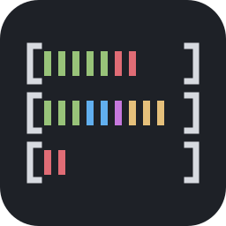
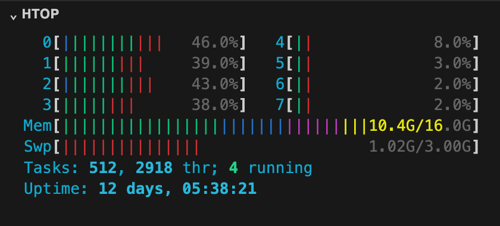

<p align="center"></p>

# htop Meters

The meters at the top of [htop](https://htop.dev) (CPU, Mem, Swp, Tasks and
Uptime) in ASCII, in a section of the VS Code side bar.



```
  0[|||||||  45.5%]  4[||        8.0%]
  1[|||||||  40.0%]  5[||        3.0%]
  2[|||||||  43.0%]  6[|         2.0%]
  3[||||||   38.4%]  7[||        2.0%]
Mem[||||||||||||||||||||||||6.32G/8.00G]
Swp[||||||||||||||||||||||||2.02G/3.00G]
Tasks: 475, 2843 thr; 7 running
Uptime: 56 days, 06:08:50
```

## What it shows

- **CPU**: one bar per core: blue = nice, green = user, red = kernel. The
  bars go in two columns when the side bar is wide enough.
- **Mem**:
  - on macOS, as in Activity Monitor: green = app memory, blue = wired,
    magenta = compressed, yellow = cached files. The number is the memory
    used (app + wired + compressed).
  - on Linux, as in htop: green = used, blue = buffers, magenta = shared,
    yellow = cache, from `/proc/meminfo`.
- **Swp**: swap used (`sysctl vm.swapusage` on macOS, `/proc/meminfo` on
  Linux).
- **Tasks**: processes, threads and running threads (`ps -A -M` on macOS,
  `/proc` on Linux).
- **Uptime**: how long the computer has been on.

The colors come from the terminal palette of the active theme, so they
match your integrated terminal. The meters update only while the section is
open and visible.

## Where it appears

The **htop** section appears at the bottom of the Explorer, Source Control,
Run and Debug, Testing and the Claude Code sessions list. Collapse it or
hide it (right-click on the side bar's title) where you don't want it. Only
the copy you can see updates, so having it in several places costs nothing.

## Settings

| Setting                       | Default | Description                                                                                                  |
| ----------------------------- | ------- | ------------------------------------------------------------------------------------------------------------ |
| `htopMeters.refreshInterval`  | `1500`  | Time between updates, in milliseconds (500–10000; htop uses 1500).                                           |
| `htopMeters.showTasks`        | `true`  | Show the Tasks line. On macOS it runs `ps` on every update.                                                  |
| `htopMeters.showInClaude`     | `true`  | Also show the section under the Claude Code sessions list. Turn it off if it appears twice in the Explorer. |

## Platforms

macOS and Linux show every meter. On Windows only CPU, the total memory used
and Uptime are shown.

In a remote window (SSH, WSL, Dev Containers) the extension runs on the
remote machine, so the meters are the remote machine's.

## Installation

**From the Marketplace**: open the **Extensions** view
(`Cmd+Shift+X` / `Ctrl+Shift+X`), search for **htop Meters** and click
**Install**, or open its
[Marketplace page](https://marketplace.visualstudio.com/items?itemName=angeloquartarone.htop-meters).

**From Open VSX** (VSCodium, Cursor, Windsurf and other editors): search for
**htop Meters** in the Extensions view, or download it from
[open-vsx.org](https://open-vsx.org/extension/angeloquartarone/htop-meters).

**From a `.vsix`**: download it from the
[releases](https://github.com/AngeloQuartarone/htop-meters/releases), then in
the Extensions view open the `…` menu → **Install from VSIX…**, or:

```sh
code --install-extension htop-meters-<version>.vsix
```

## Build

```sh
npm install
npm run package
```

## License

MIT — see [LICENSE.md](LICENSE.md).
